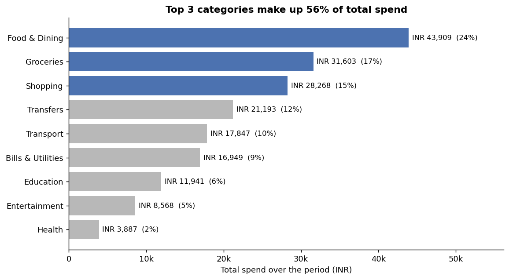
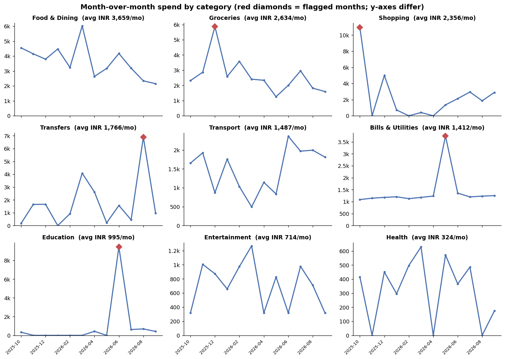
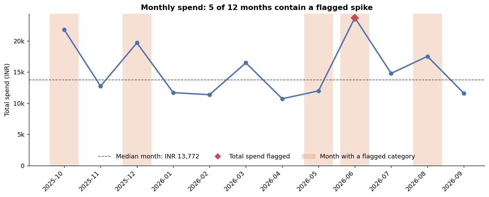
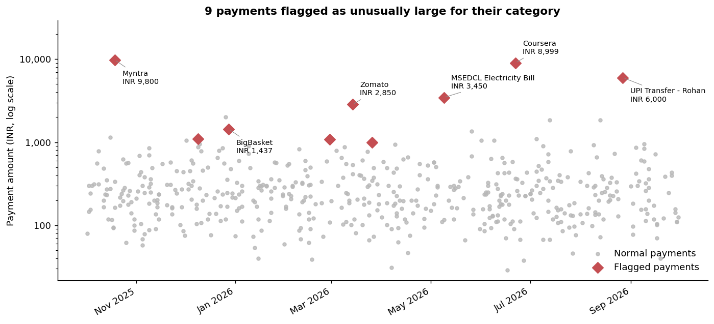

# UPI Spending Analyzer

A Python tool that tracks personal UPI spending over time, shows **month-over-month trends by
category**, ranks the **largest contributors to total spend**, and **flags unusual spikes**
(single payments or whole months) using robust statistics. It also exports Power BI-ready CSVs.

> **About the sample data:** `data/sample_upi_transactions.csv` is **synthetic**. It is generated by
> `generate_sample_data.py` (fixed seed) and contains five deliberately injected unusual payments so
> the detectors can be tested against a known answer. It is not anyone's real transaction history.

## What it does

| Step | Module | Details |
|---|---|---|
| Load & validate | `upi_analyzer/cleaning.py` | Accepts common column names, parses `DD/MM/YYYY` and ISO dates, strips `Rs.` / `INR` / commas, handles separate debit/credit columns, drops unusable rows and **reports how many** |
| Categorise | `upi_analyzer/categorize.py` | Keyword rules (Food, Groceries, Transport, Bills, Entertainment, Shopping, Health, Education, Transfers, Others) - easy to extend |
| Detect anomalies | `upi_analyzer/anomalies.py` | Per-category **payment** outliers and **monthly spikes** (details below) |
| Report | `upi_analyzer/reports.py` | Monthly pivot, MoM change, category share, 4 charts, CSV exports |

## Quick start

```bash
pip install -r requirements.txt
python run_analysis.py                       # analyse the bundled synthetic sample
python run_analysis.py --input my_statement.csv   # analyse your own export
python -m unittest discover -v               # run the tests
```

Outputs are written to `outputs/`: four PNG charts, `summary.txt`, and the CSVs
`powerbi_transactions.csv`, `monthly_category_summary.csv`, `category_contribution.csv`,
`anomalies_transactions.csv`, `anomalies_monthly.csv`.

### Using your own data

Export your UPI / bank statement to CSV with at least `date`, `description` (payee) and `amount`
columns, plus `type` (`DEBIT`/`CREDIT`) if available. Without a `type` column, positive amounts are
treated as spends and negative ones as credits. Keep real statements in `data/private/` - it is
git-ignored so personal financial data is not uploaded by accident.

## How anomalies are flagged

Spending is skewed (a few large purchases, many small ones), so the detectors use the **median and
MAD** (median absolute deviation) instead of the mean and standard deviation, which outliers would
distort.

1. **Payment anomalies** - within each category, a payment is flagged if its *modified z-score*
   `(x - median) / (1.4826 x MAD)` is above **3.5** *and* it is at least **INR 500** above the
   category median. The INR 500 floor is a practical-significance filter, so tiny differences are
   not flagged. Categories with fewer than 8 payments are skipped.
2. **Monthly spikes** - for each category (and the overall total), each month is compared with the
   median of the *other* months. It is flagged if its robust z-score is above **3.5**, it is at least
   25% above the baseline, and at least INR 500 above it.

Thresholds can be changed with `--txn-threshold`, `--monthly-threshold` and `--min-increase`.
Only unusually *high* spending is flagged, nothing is deleted, and a flag means "worth a look", not
"error" or "fraud".

## Results on the sample data

Total synthetic spend is INR 184,165 over 12 months. The top three categories (Food & Dining,
Groceries, Shopping) account for 56% of it.






All 5 injected payments are flagged (plus 4 naturally large grocery / transfer payments), and the
injected spike months (Oct 2025 shopping, May 2026 electricity, Jun 2026 education, Aug 2026
transfers) are detected. See `summary.txt` for the full list.

## Power BI dashboard

The CSVs in `outputs/` are shaped for Power BI. `docs/powerbi_guide.md` explains how to build the
dashboard (data model, DAX measures and suggested visuals). The `.pbix` file is not included.

## Limitations

- Categorisation is keyword-based; unknown merchants land in "Others".
- With about 12 months of history, monthly baselines are based on few points, so treat monthly
  flags as prompts to review rather than conclusions.
- Thresholds were chosen as common defaults and checked on synthetic data only.
- Statement formats differ between banks and apps; the loader handles common layouts but you may
  need to rename columns for yours.

## Project layout

```
upi_analyzer/        cleaning.py, categorize.py, anomalies.py, reports.py
tests/               unit + end-to-end tests (python -m unittest discover)
data/                synthetic sample data
docs/                Power BI build guide
outputs/             generated charts and CSVs (for the sample data)
generate_sample_data.py   run_analysis.py
```

## License

MIT - see `LICENSE`.
